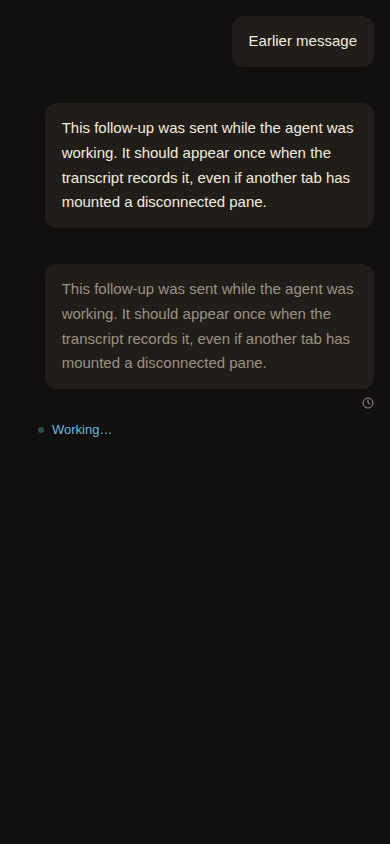
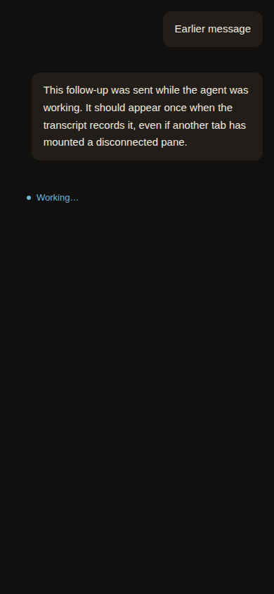
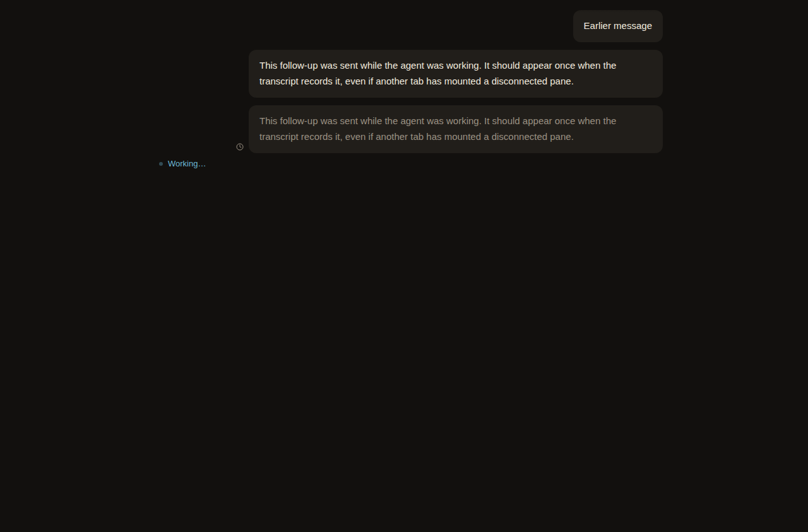
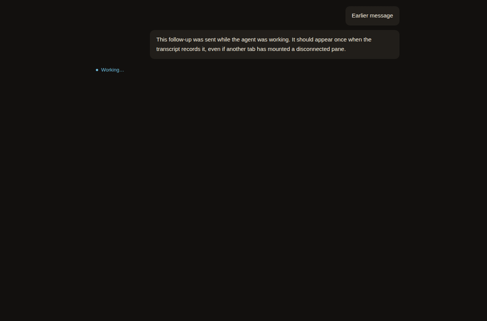

# Ovis 0.4.22 fork update evidence

This branch stores verification artifacts for the fork update. It has no parent commit in the application history and is not intended to merge into the default branch.

The test results come from isolated fixtures and fictional conversations. They are automated regression evidence, not observations of a real Codex conversation or normal phone use. Deployment checks establish which version was served and whether existing connections and launcher definitions survived the update.

New dogfooding screenshots and recordings belong here with their device, browser, date and action sequence. Private conversations, credentials and runtime configuration must not be published.

## Stale waiting bubble reproduction

The same isolated browser fixture compares upstream v0.4.22's `SentWaiting.tsx` cleanup with the fork's cleanup at `6e09c56e42bdafac7619b4a7bb95e0e755fed740`. The rest of the fixture comes from the fork. This is a component-level reproduction, not a clean full upstream deployment.

With a disconnected sibling pane and a browser clock two seconds ahead, upstream's cleanup leaves one faded waiting copy beside the recorded user turn. The fork clears that copy. The fixture issues GET requests to its own server and sends no terminal input. Both widths passed their expected assertions.

| Width | Upstream cleanup | Fork cleanup |
| --- | --- | --- |
| Phone, 390px |  |  |
| Desktop, 1280px |  |  |

Run `bun /path/to/reproduce.ts --upstream` and `bun /path/to/reproduce.ts` from the application checkout, with the v0.4.22 tag available. The script and result JSON files are on this branch.

## Verification

`verification-summary.json` records the completed full check run: 10,611 unit tests, 1,022 integration tests and 138 browser scripts passed. The source remained unchanged during that run. The two existing infrastructure suites also passed all 15 tests.
