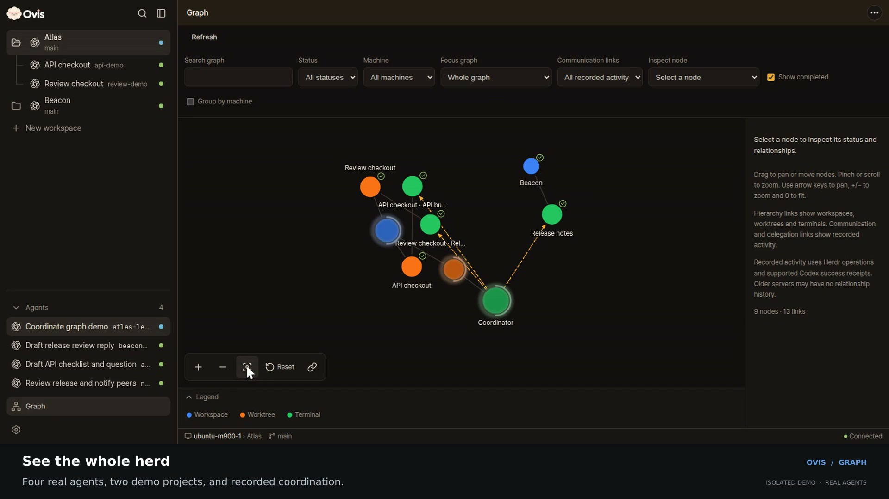

# Ovis Graph: herding parallel agents

[Download the MP4](graph-demo.mp4) · [Captions](captions.vtt)

An Obsidian-inspired overview of projects, checkouts and agents. This recording shows four real Codex agents in an isolated Herdr session, coordinating on fictional Atlas and Beacon tasks. The links come from observed operations: 3 delegations and 10 communications were present at the final inventory read. They are grouped into directed relationships in the UI.

The workflow shows live activity, the Working filter, coordinator selection, relationships at checkout and workspace levels, direct workspace-to-terminal links with worktrees hidden, and opening the selected terminal.

## Recording

- Source revision: [`2504d40b01e2877dc1786581a47893c87a4dcedf`](https://github.com/christso/ovis/commit/2504d40b01e2877dc1786581a47893c87a4dcedf), merged in [#48](https://github.com/christso/ovis/pull/48).
- 64.60 seconds · 1920 × 1080 · 30 fps · H.264 / yuv420p · fast-start MP4 · no audio.
- File size: 4,025,168 bytes.
- SHA-256: `73083b3d8bc2b75145580f8720324ba13ad435c7ca53876e25116147028abc1e`.
- Real Ovis client and server from that revision, real Herdr terminals and coding agents, disposable projects, short demo messages, browser-automated interactions, edited for pacing. Only the cursor indicator and explanatory footer were added for the recording.
- Communication evidence in this recording comes from the installed Herdr fork's coordination journal. The Graph also supports optional local CLI observations; the clip does not demonstrate every capture path or claim a complete communication history.
- Recorded on desktop Chrome/Linux. Mobile interaction and remote PCs are not shown in this clip.
- No existing user panes, credentials, or private project content were recorded. The demo Herdr and Ovis runtimes were stopped after capture.

## Verification

The retained clip shows the asserted node types and projected relationships at each level, Working filtering while agents were active, and exact terminal navigation. The full capture also checked focus/search context. No browser page errors occurred. The source revision's required Fast checks, Integration and browser, and Native Windows checks passed in #48; its macOS job never acquired a hosted runner. No application code was changed for this recording.

The finished MP4 was checked for its codec, dimensions, duration, compatible pixel format, fast-start metadata and hash. The retained workflow and chapter frames were reviewed, and desktop Chrome playback reached the end without errors before publication. See [proof.json](proof.json) for measured scene counts and timing.

This branch contains only demo assets and has no parent commit from the application's history.
