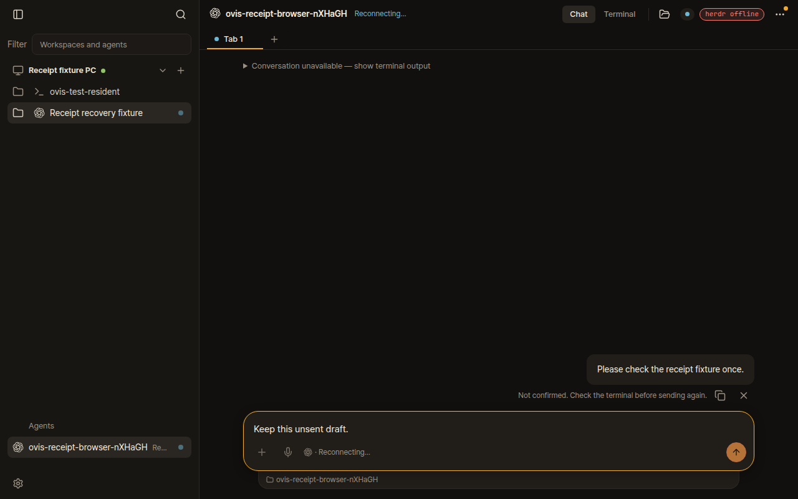
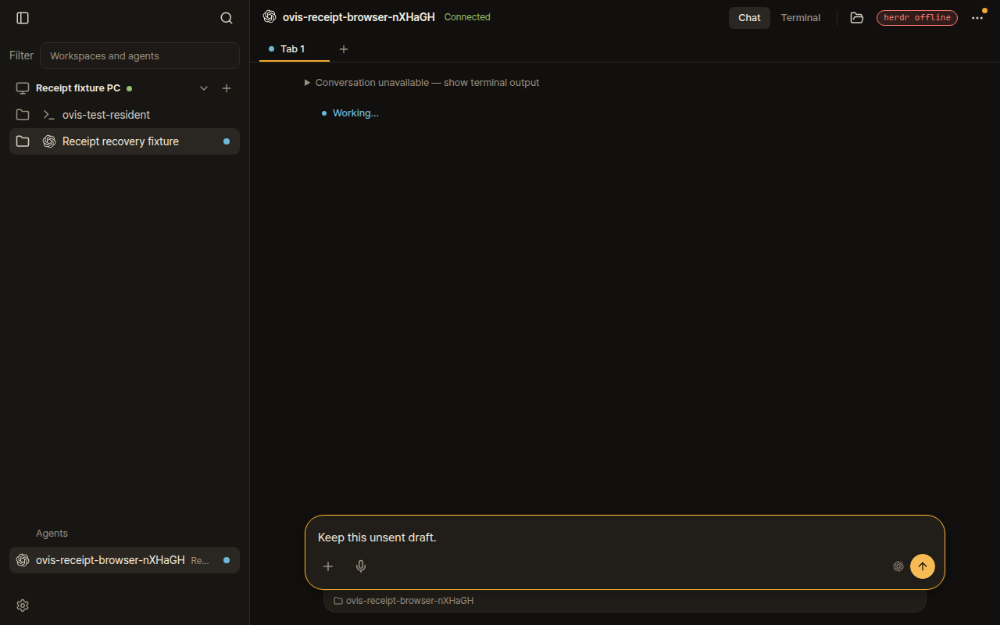

# Remote follow-up receipt recovery — PR #2792

Evidence for [devswha/ovis#2792](https://github.com/devswha/ovis/pull/2792), application commit
`62db905689ef32ee8fc883c78e3b110838835a5b`, based on upstream `b2d9e5d7`.
This evidence branch is orphaned from application history and is not intended for merging.

## Browser capture

These are automated isolated-fixture screenshots, **not native-agent or live-device dogfooding**.
Chromium runs the built Ovis app. A real connection server relays the browser's paired-device
connection through `MachineRelay` to a real loopback bridge and an isolated herdr session.
The remote PC roster/endpoint is injected; SSH transport is not used in this browser fixture.
The foreground `codex` process is a synthetic raw-input recorder, not a model invocation.

The browser queues one follow-up. The fixture drops the bridge's exact sent receipt and closes
that socket after the recorder received the follow-up. The saved copy becomes Not confirmed.
The same browser/device then reconnects, receives the exact resumed sent receipt, and removes
the unconfirmed copy. Terminal bytes and browser submit counts remain unchanged; the unsent
draft survives. Both screenshots show the **same fixed application revision**, at different
points in the reconnect sequence; they are not an upstream-versus-fixed screenshot comparison.
The local-PC health badge is outside the assertion: the fixture publishes only the remote roster.

| Lost receipt, before reconnect | Exact receipt recovered |
| --- | --- |
|  |  |

The [queued state](01-queued-remote-follow-up.png), [machine-readable assertions](browser-result.json)
and [reproduction script](reproduce.ts) are also retained.
Run from the application checkout with its dependencies and Chrome installed:

```sh
OVIS_QA_EVIDENCE=/tmp/receipt-evidence bun run check run --build bun /path/to/reproduce.ts
```

## Checks (initial capture)

- The two new sent/discarded contract cases failed on upstream before the production fix at
  retained-receipt recovery, then passed after it; [red summary](checks/red-receipts-summary.log).
- Full pending-input contract: 120 passed. Device-access and ping contracts: 27 passed.
- Relay transport contract: 17 passed. Relay unit tests: 14 passed.
- Final fast gate: 11,250 passed, zero failures, 44 repository skips; generated files,
  workflow syntax, typecheck and production build passed.
- Disposable OpenSSH integration: all eight PASS groups, including reconnect/restart and
  observer enforcement; Node PTY fallback. This is independent from the browser fixture.
- Read-only code review found one stale relay contract assertion; it was fixed and verified.
  No unresolved findings. External peer review could not initialize; local adversarial fallback ran.

See [check receipts](checks/) and the exact commands in the application PR's Validation section.
In the initial capture, full integration/browser lanes, native Windows/Mac, a Rust PTY host
and live/native-agent usage were not exercised. Receipt expiry/eviction and server restart can still leave a copy
unconfirmed. No automatic resend is introduced.

## Additional adversarial behavior pass

[Forty adversarial browser/bridge scenarios](adversarial/README.md) passed on upstream PR #2792 and the installed fork source, including the installed Rust PTY host. This later pass improves the original coverage above. It remains isolated fault-injection evidence; real/native-agent or phone dogfooding and a sustained soak are still unperformed.
