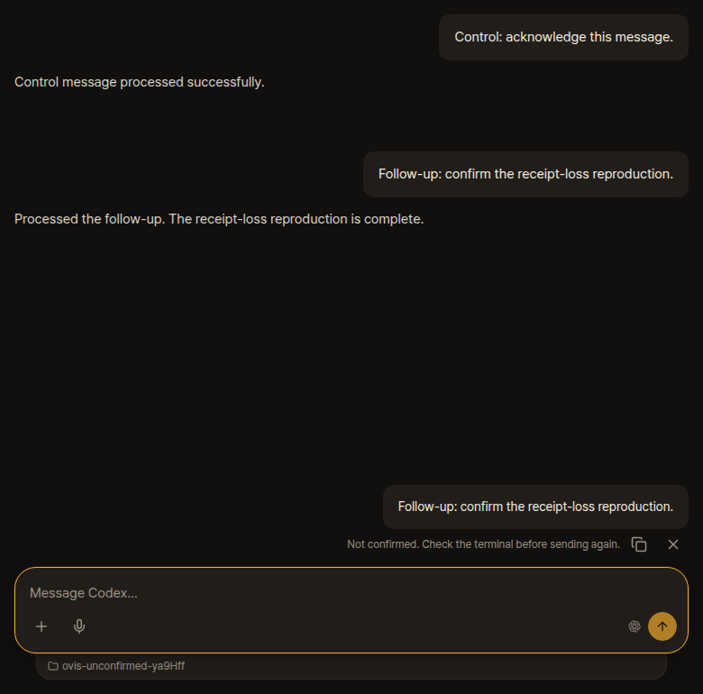
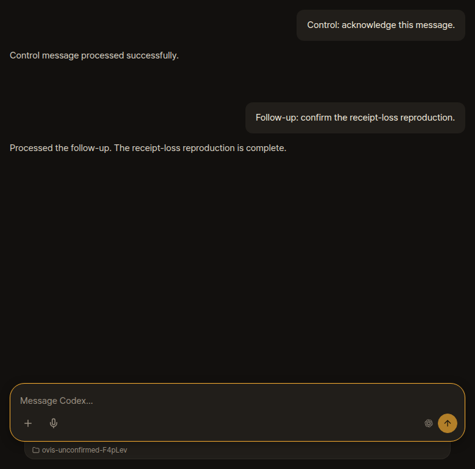

# A completed Codex message stays Not confirmed

Captured against upstream `b755fc5d5b0072acc488c549ceedee77e359f789` (Ovis 0.4.20), Herdr 0.9.5, Bun 1.4.3, Linux x64 and headless Chrome 155.0.8059.39. The original user report was on an installed Ovis 0.4.13 bridge with Codex CLI 0.166.0. The browser's original failure trigger is unknown.



This is a deterministic transport reproduction, not a native Codex model run. It uses a byte-recording process named `codex`, an isolated Herdr session, a real Ovis server and browser, and a fictional Codex-format transcript read by Ovis's native transcript reader. It uses no private conversation, device credentials or live-session screenshot.

Run from the repository root after `bun install --frozen-lockfile` and `bun run build`:

```sh
bun run check run bun docs/codex-unconfirmed/reproduce.ts
```

The script first queues and delivers a control message with no connection failure. It asserts that the message reaches the terminal once and its pending row disappears. It then queues a follow-up and intercepts only its successful `pending-messages.removed` receipt. Once the server has reported `outcome: sent`, the browser-facing WebSocket closes before that receipt reaches the page. This deliberately models receipt loss, not failure to deliver the message.

The recorder receives the follow-up's bracketed paste and Enter exactly once. The script writes a completed fictional user/assistant exchange only after verifying those input bytes. The browser reconnects, then reloads. Chat displays the completed exchange from the transcript, while the recovery copy below it still says “Not confirmed. Check the terminal before sending again.” Neither reconnect nor reload writes any additional input.

`result.json` records the control, delivery events, connection count and assertions. A rerun writes its screenshot and results to the ignored `evidence/codex-unconfirmed/` directory, or `UI_EVIDENCE_DIR` when set. The published copies are beside this README. The test cleans up its own workspace, browser, temporary store and isolated Herdr session. The new Herdr worktree used for the investigation remains available separately.

## Explanation

In `server/core/pending.ts`, a normal client's pending-message removal is sent only to that connection. Attach replays first-message dispositions and resumable Pi receipts, but it does not replay an ordinary Codex pending-message disposition to the returning browser. In `src/lib/machineSession.ts`, disconnect suspends that connection's pending rows. `PendingMessageStore.suspend` drops their live ownership and changes a sending row to uncertain. An empty snapshot from a new connection deliberately cannot clear that saved copy.

The conservative handling avoids resending a delivered message. The unresolved behavior is presentation recovery: the bridge has successfully delivered it, but the returning page cannot recover that exact delivery outcome. Matching transcript text alone would not safely establish message identity. A possible improvement is to retain and resume the exact delivery disposition for the same authenticated browser/device and message ID, without granting permission to send anything.

## Original reproduction validation

- `bun run build`: passed.
- `bun run check run bun docs/codex-unconfirmed/reproduce.ts`: passed, including the no-failure control, exact input bytes, reconnect, reload and screenshot.
- No application implementation was changed. This evidence reproduces one triggering condition; it does not establish why the original browser lost confirmation.
- `bun run check fast`: failed one unchanged installer test, `scripts/install-node-fallback.test.ts:299`, which expected `[ node]` and received `[]`. Workflow syntax, generated types/themes, typecheck and build passed. No installer change was made as part of this report.
- Full integration/browser/native Windows suites were not run for this evidence-only branch.

## Fork fix

The fork now retains ordinary pending-message dispositions using the same browser/device resume
identity as Pi's existing receipt recovery. It stores at most 1024 sent/discarded outcomes for ten
minutes and replays the exact ID on reattach. If the committed Enter's reply arrives after a
successor has already attached, that successor receives the outcome immediately. This does not
paste or submit anything, resume a queued message,
or treat matching conversation text as confirmation. Missing receipts remain uncertain.

The [OpenClaw research](openclaw-research.md) explains the source-backed comparison: ACPx's
passive outcome journal and OpenClaw's exact request-ID reconciliation solve a similar separation
between delivering a prompt and showing its outcome. Ovis keeps its existing terminal send path.

The fork was merged with upstream `3c679791` while preserving saved launchers, custom Codex and
OMP stores, and navigation fixes. To verify the patched behavior with the same fault injection:

```sh
EXPECT_RECEIPT_RECOVERY=1 bun run check run --build bun docs/codex-unconfirmed/reproduce.ts
```

The check verifies one paste and Enter for each message, an exact resumed delivery receipt,
the completed native-format transcript, no duplicate recovery row, and no further terminal input
after reconnect and reload. It uses the same stand-in and fictional data as the original evidence.

| Before | After receipt recovery |
| --- | --- |
|  |  |

The fixed run's events and assertions are in [result-fixed.json](result-fixed.json). This covers
the reproduced receipt-loss case. A bridge restart or a receipt that predates retention cannot
be reconstructed; an old uncertain copy still needs review and manual dismissal.

Receipt resumption keeps Ovis's existing direct-bridge limit: the remote-PC relay strips the
browser resume ID because its shared bridge token does not identify the originating device.
Routed remote sessions therefore keep the existing conservative behavior. A stale tab can also
write an old saved copy after another tab settled it; after a reload and expiry of the server's
receipt, that copy remains uncertain rather than being guessed delivered.

Coverage includes both reconnect orderings, exact message IDs, no extra input, device/browser
isolation, read-only and revoked clients, retention bounds, and uncertain-row expiry. The existing
110-case pending contract suite passed before the final ordering adjustment; all three targeted
receipt contracts and 64 store/history/core tests passed after it. Fork browser checks also passed
for saved launchers, new-session fields, worktree selection and deep-link navigation.

Final verification on implementation commit `d61b552e214593d02a04209f2da7792015c7c317` passed
`bun run check fast` (workflow syntax, generated types/themes, typecheck, build and the full unit
suite), all three receipt contracts, and the screenshot replay above. Independent review's one
ordering finding was fixed and its closure verified. Full integration/browser lanes and native
Windows checks were not run; the targeted Linux checks are the evidence for this fork change.
