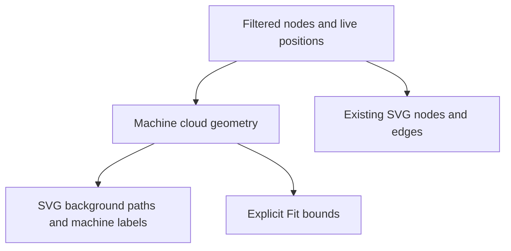

# Flock Machine Clouds - Plan

## Goal Capsule

**Objective:** People can see which machine each Flock tab belongs to while the communication graph moves.
**Means:** Add labelled, translucent machine clouds to the existing Group by machine view.
**Authority:** The agreed cloud design governs behavior; repository instructions govern checks and delivery.
**Execution:** One independent PR from `origin/christso/main`, containing this plan, implementation, documentation and tests. The implementing session opens the PR; the maintainer merges.
**Stop conditions:** Preserve work and report any blocker that prevents the required UI checks.

## Product Contract

### Summary

Group by machine draws a soft cloud behind each represented machine's visible nodes.
Clouds reshape with the existing force simulation and dragging, while nodes retain repository colours.

### Problem Frame

Machine grouping currently attracts nodes toward columns without showing group boundaries or names.
Users must inspect individual tabs to confirm machine membership as nodes move.

### Key Decisions

- **Machine identity belongs on the background.** Keep repository identity on node fill. Governs R1, R3. (session-settled: user-approved — chosen over machine-coloured nodes and rigid columns: clouds preserve both machine and repository context.)

### Requirements

**Clouds**

- R1. Show one cloud per known machine with positioned visible nodes when Group by machine is enabled; hide clouds when it is disabled.
- R2. Each cloud has a padded rounded boundary around its members, including one-node and two-node groups, and follows their current positions and sizes.
- R3. Give each machine a stable subtle colour and a readable machine-name label, falling back to its ID; retain existing node colours and status icons.
- R4. Update clouds with the existing graph frames and stop updating when the graph settles; reduced motion adds no independent animation.

**Interaction and lifecycle**

- R5. Draw clouds behind edges and nodes, with no pointer or keyboard targets, preserving node selection, dragging, pan and zoom.
- R6. Recompute membership from the filtered graph so empty groups disappear; omit nodes without machine identity or positions.
- R7. Explicit Fit and grouping reset include cloud extents without adding automatic refits on polls or drags.
- R8. Reuse the saved grouping toggle and machine metadata without new server contracts, dependencies or settings.

### Scope Boundaries

This PR adds the cloud visualization to existing grouping; it does not replace the force layout, add cloud-drag controls, add a colour-mode selector, change link weighting, or change node sizing from PR #34.
It does not change herdr or submit an upstream request.
A new cluster-separation engine is considered and not built: this is a visual envelope over existing grouping, and layout tuning can follow visual evidence of overlap.

## Planning Contract

### Key Technical Decisions

- KTD1. **Derive geometry from the rendered positions.** A small pure helper in `src/features/graph/graphMachineClouds.ts` groups known machines and computes padded rounded hulls from the node discs. Stable ordering avoids roster-order noise. Implements R1, R2, R6.
- KTD2. **Render within the existing SVG viewport.** `GraphSurface` draws noninteractive paths and labels before edges, using existing machine names and the graph's colour function with machine-specific keys. The same frame owns nodes and clouds. Implements R3–R5, R8.
- KTD3. **Use cloud bounds for explicit framing.** `GraphView` includes derived group bounds alongside node positions when invoking its existing Fit operation. Implements R7.
- KTD4. **Keep the existing grouping force.** The current simulation remains authoritative; clouds do not add another timer or move nodes themselves. Implements R4, R8.

### High-Level Technical Design

Directional data flow:

### Assumptions

Clouds appear only with the existing grouping toggle, including a single represented machine.
Soft visual envelopes may overlap when members are manually dragged between clusters; overlap does not change membership.
The plan is independent of the open communication-sizing PR and consumes the existing appearance calculation.

## Implementation Units

### U1. Render moving machine clouds

- **Goal:** Implement R1–R8 using KTD1–KTD4.
- **Files:** `src/features/graph/graphMachineClouds.ts`, `src/features/graph/graphMachineClouds.test.ts`, `src/features/graph/GraphSurface.tsx`, `src/features/graph/GraphView.tsx`, `src/features/graph/GraphView.css`.
- **Approach:** Add deterministic geometry, pass grouping and machine names to the surface, render low-contrast clouds behind graph content, and include their bounds in explicit Fit.
- **Patterns:** Follow `graphAppearance.ts` for colour identity and radii, `graphLayout.ts` for coordinates, and `GraphSurface.tsx` for readable screen-space labels and SVG layering.
- **Test scenarios:** Empty and unknown-machine inputs produce no clouds; one node, two coincident nodes and collinear nodes have finite closed boundaries; separate machines stay distinct; radius changes enlarge bounds; moving a node reshapes its cloud; translation moves geometry consistently; roster reversal leaves geometry unchanged.
- **Test seam:** Pure geometry tests prove membership and bounds; browser tests in U2 prove rendering and interaction.
- **Verification:** Geometry tests and existing graph tests pass before integration.

### U2. Verify grouped graph behavior and document it

- **Depends on:** U1.
- **Files:** `scripts/graph-browser-regression.ts`, `scripts/graph-fixture.tsx` if an additional fixture action is needed, `DESIGN.md`, `docs/flock.md`, `changelog.d/flock-machine-clouds.md`.
- **Approach:** Extend existing grouped-view and animated checks, preserving their original navigation, viewport and selection coverage.
- **Test scenarios:** The toggle adds named clouds and removes them when off; machine filtering removes the other cloud; repository node colours stay unchanged; node drag changes the cloud path; background pan and node selection work through the cloud; clouds follow zoom with the graph; settled polling does not change paths; desktop and narrow phone layouts pass in light and dark themes.
- **Patterns:** Follow the synthetic isolated fixture in `scripts/graph-browser-regression.ts` and integrated app fixtures in the other two graph scripts.
- **Verification:** Run all three graph browser scripts in the CI runner image as its own user and inspect synthetic screenshots for cloud shape, labels and contrast.

## Verification Contract

Run `bun test src/features/graph` for geometry and existing model/simulation behavior.
Run `bun run check fast` on the final unchanged source before pushing.
Run `scripts/graph-browser-regression.ts`, `scripts/graph-app-demo-regression.ts` and `scripts/flock-herdr-graph-regression.ts` in `local/ovis-ci-upstream-sync:20261109` as `runner`, with isolated synthetic state.
All local tests use a task-specific `TMPDIR` beneath `~/.cache/ovis-tmp/`.
Record exact checks and skips in the PR; full unrelated browser/integration and native Windows/macOS runs are outside local verification.

## Definition of Done

Clouds meet R1–R8, the named unit and browser checks pass, and screenshots show readable clouds in both themes.
The plan, implementation, design notes and changelog ship together in an open PR.
Remove abandoned code and task scratch state; retain the managed worktree for the open PR.

## Sources

The current grouping and simulation are in `graphSimulation.ts`, `useGraphSimulation.ts`, and `GraphView.tsx`.
[Zed's Agent Panel](https://zed.dev/docs/ai/agent-panel) groups threads by project; Ovis keeps repository colours but uses machine clouds because its graph spans computers.
[yEd's organic swimlanes](https://yed.yworks.com/support/manual/layout/layout_organic_swimlane.html) provide a comparison for rigid placement; these clouds instead follow the existing force positions.

