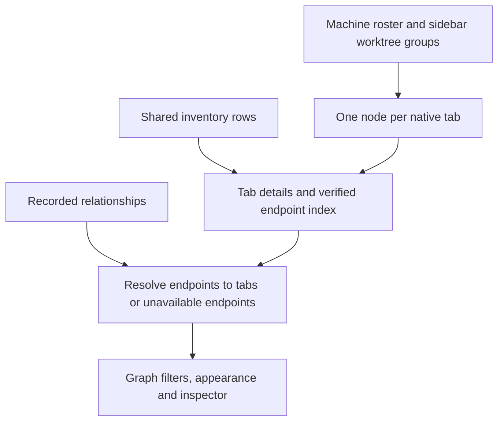

# Flock Workspace Tabs - Plan

## Goal Capsule

**Objective:** People can recognize their workspace's tabs and worktrees in Flock without seeing several nodes for the same open work.
**Means:** Project the native workspace/tab hierarchy into the graph (KTD1).
**Authority:** The user's agreed tab-based design and worktree clarification govern product behavior; repository instructions govern implementation and checks.
**Execution:** One PR containing this plan, implementation, documentation and regression coverage. The implementing session verifies and opens it; the maintainer merges.
**Stop conditions:** A launch-blocking conflict with existing identity guards, or inability to perform required checks, is reported with preserved work.

---

## Product Contract

### Summary

Flock represents open work through native tabs, including tabs inside the worktree workspaces nested under a workspace in the sidebar.
Repository, branch, checkout and agent/session facts appear in details and filters instead of additional nodes for that tab.

### Problem Frame

Selecting `infra` currently exposes the repository and its `main` checkout before the work people recognize by name.
A synthetic workspace with three tabs produces five graph nodes, and observed agent/session identities can add further nodes for the same live terminal.
People expect the graph to reflect the workspace navigation they already use.

### Key Decisions

- **Recognizable work is the visible unit.** Governs R1–R3. (session-settled: user-approved — chosen over repository/checkout/session/execution layers: those layers repeat the same work and obscure tab names.)
- **Sidebar worktrees count too.** Governs R1 and R4. (session-settled: user-directed — chosen over horizontal tabs alone: nested worktree entries are also part of the user's workspace.)

### Requirements

**Visible work and context**

- R1. Every nonempty native tab is represented once, whether it belongs to a main workspace or a linked worktree workspace; recognized agents and split panes do not add duplicate nodes.
- R2. Names reuse the native tab and sidebar workspace names; a worktree's sole numbered tab is recognizable by its sidebar workspace name.
- R3. Repository, branch, checkout, agent and logical-session information remains inspectable on the represented work, without separate metadata nodes.
- R4. Focusing a workspace includes its own tabs and the worktree workspaces grouped beneath it by the sidebar; focusing an individual worktree includes that worktree's tabs.

**Relationships and navigation**

- R5. Recorded delegation and communication connect represented tabs, keeping receipt counts, provenance and timestamps; no relationship is inferred from shared paths or branch names.
- R6. An observed endpoint without a represented current tab may remain a historical/unavailable node, but must not duplicate a represented endpoint or authorize a replacement terminal.
- R7. Open in Workspace resolves a current exact tab/terminal target and preserves the existing passive-selection behavior, including unavailable and disconnected states.
- R8. Search, machine/status filters, colors, saved graph state, keyboard/touch interaction and watch-only access continue to work with the tab projection.

### Acceptance Examples

- AE1. Covers R1–R4. `infra` with horizontal tabs `obsidian`, `phone`, `social` shows those three work nodes when focused; `infra` and `main` are context rather than extra nodes.
- AE2. Covers R1, R2, R4. `infra` with linked worktree workspace `phone` and its sole numbered native tab shows a node named `phone`; it appears in the parent workspace focus and can open that worktree's terminal.
- AE3. Covers R1, R2. A worktree with several horizontal tabs shows each tab once with enough workspace context to distinguish them, without an additional container node for the same worktree.
- AE4. Covers R5–R7. Two agents in one split tab contribute one tab node; recorded cross-tab activity resolves to the corresponding tab, and replacing a terminal invalidates its old open target.

### Scope Boundaries

This is a graph presentation change. The registry, retained migration APIs, native session ownership, terminal lifecycle and sidebar behavior retain their existing contracts.
No manual relationship editor or new user setting is needed.

---

## Planning Contract

### Key Technical Decisions

- KTD1. **Use the full native roster as the node source.** Replace the agent-versus-shell split in `graphTabs.ts` and the metadata-node expansion in `graphInventory.ts`; keep inventory rows as metadata and relationship evidence for R1–R3.
- KTD2. **Share sidebar grouping semantics.** Use `worktreeGroups` from `src/lib/workspaceOrder.ts`, scoped to a machine's workspace order, for R4. Membership uses reported `repo_key` and the nearest preceding main-checkout workspace, with the helper's existing fallback; matching repository paths alone is insufficient.
- KTD3. **Separate graph focus from rendered nodes.** Workspace focus options carry machine/workspace identity and membership independently of the node list, so R4 does not require drawing a repository or workspace container node.
- KTD4. **Resolve receipts before projecting endpoints.** Map existing verified row/endpoint identities to the containing tab, aggregate parallel receipts without counting duplicate captures, and retain unrepresented endpoints under R5–R6. A same-tab relation must not produce a second node or inflate its connection degree.
- KTD5. **Keep location and agent-occupant identity in tab IDs and action-time resolution.** Machine, workspace, daemon lifetime, native tab and exact pane/terminal membership remain the location boundary for R7. Agent panes additionally retain their reported native-session or exact Herdr endpoint identity, and open through `flockTarget`; identity metadata alone never proves ownership. Renames, ordering, status and optional proof refresh retain the same node; replaced occupants, terminals or pane membership invalidate the old target. Missing proof disables an agent tab's target rather than falling back to another shell pane in a mixed tab.
- KTD6. **Retain repository colors through metadata.** Adapt appearance and legend generation to node membership rather than relying on visible repository nodes for R3 and R8. Distinct machines and workspace/tab identities remain distinct even when names coincide.

### High-Level Technical Design

### Assumptions

For a linked worktree's sole unnamed tab, its workspace label is more useful than `Tab 1`; multiple or explicitly named tabs retain their tab names with workspace context.
Existing graph selections referring to retired metadata nodes may show the existing unavailable-selection state, while workspace focus must remain usable without metadata nodes.
The existing Folio-inspired graph gestures remain appropriate; navigation follows Ovis's native sidebar/tab strip and the project/thread distinction documented for Zed in `DESIGN.md`.

---

## Implementation Units

### U1. Project workspace work into tab nodes

**Goal:** Deliver recognizable, nonduplicated nodes and workspace membership.
**Requirements:** R1–R4, R7; KTD1–KTD3 and KTD5.
**Dependencies:** None.
**Files:** `src/features/graph/graphTabs.ts`, `graphNames.ts`, `graphInventory.ts`, `graphModel.ts`, `graphNames.test.ts`, `graphInventory.test.ts`, `graphModel.test.ts`.
**Approach:** Centralize tab identity, labels, pane membership and workspace grouping in the projection; attach relevant checkout/agent/session facts instead of expanding them into nodes.
**Test scenarios:**

- Covers AE1. Three named horizontal tabs produce exactly three work nodes under `infra` focus.
- Covers AE2 and AE3. Nested worktrees with one default tab and several custom tabs stay recognizable and appear under their correct parent, including multiple main checkouts sharing a repository.
- Covers AE4. Mixed shell/agent split panes produce one node, and replacement terminals, pane-set changes, restore errors and disconnects cannot reuse an old open target.
- Renaming and reordering preserve node identity; equal tab labels on different machines stay distinct.

**Verification:** Pure graph tests prove projection, filtering and target resolution; they do not prove browser interaction or native terminal behavior.

### U2. Connect recorded activity and adapt the inspector

**Goal:** Preserve meaningful relationships and graph controls on the new nodes.
**Requirements:** R3–R8; KTD3, KTD4 and KTD6.
**Dependencies:** U1.
**Files:** `src/features/graph/graphInventory.ts`, `graphAppearance.ts`, `graphAppearance.test.ts`, `graphInventory.test.ts`, `GraphPanel.tsx`, `GraphView.tsx`, `graphLabels.ts`, and the existing graph i18n dictionaries when wording changes.
**Approach:** Resolve relationship endpoints to represented tabs, expose workspace focus options, and render retained metadata in the inspector and repository legend.
**Test scenarios:**

- A verified live endpoint joins its tab once while unrepresented historical children remain unavailable.
- Multiple recorded endpoint pairs between the same tabs preserve counts and sources without duplicate graph links or artificial connection degree.
- Search and machine/status/workspace filters retain the relevant tab metadata and recorded relationships.
- Colors follow repository metadata across machines; unknown or ambiguous membership stays neutral.

**Verification:** Existing inventory/appearance tests prove identity and aggregation; browser coverage proves focus controls, details and Open in Workspace.

### U3. Verify and document the complete experience

**Goal:** Make the agreed design reviewable on desktop and phone.
**Requirements:** R1–R8 and AE1–AE4.
**Dependencies:** U1, U2.
**Files:** `scripts/graph-app-demo-regression.ts`, existing graph/browser regression scripts affected by the node model, `DESIGN.md`, `docs/flock.md`, and a `changelog.d/` fragment.
**Approach:** Update fixtures and assertions around visible tabs, nested worktrees, relationship aggregation and navigation; replace documentation describing metadata nodes with the final presentation model.
**Test scenarios:**

- Desktop and phone graph views show horizontal and nested worktree tabs, readable details and working workspace focus.
- Opening a tab reaches its expected workspace without native focus/input operations.
- Refresh, Back/Forward, selection replacement, unavailable inventory and watch-only behavior retain their existing guarantees.

**Verification:** Demo/browser fixtures prove app behavior and responsive geometry; native Windows/iOS checks remain separately reported when skipped.

---

## Verification Contract

Run the focused graph unit files, then `bun run check fast` before the single final push.
Run `scripts/graph-browser-regression.ts`, `scripts/graph-app-demo-regression.ts` and `scripts/flock-herdr-graph-regression.ts` in the self-hosted CI runner image as its own user, following `docs/development.md` and `AGENTS.md`.
Use an owned cache-backed `TMPDIR`, isolated test sessions, temporary state directories and `port: 0`; screenshots and recordings use fictional demo/test data.
The PR Validation names exact commands, outcomes and skipped integration/native lanes; the PR includes this plan and cites the existing Ovis/Zed navigation reference.
No release guard or bundle validation is newly required unless implementation expands into its governed paths.

---

## Definition of Done

AE1–AE4 are covered by passing projection/browser evidence, relevant checks pass, and implementation units have no unresolved functional gaps.
Documentation and changelog describe the resulting behavior, the PR contains the plan, and abandoned experiments are absent from the diff.
The session stops at a verified open PR with validation and limitations recorded.
