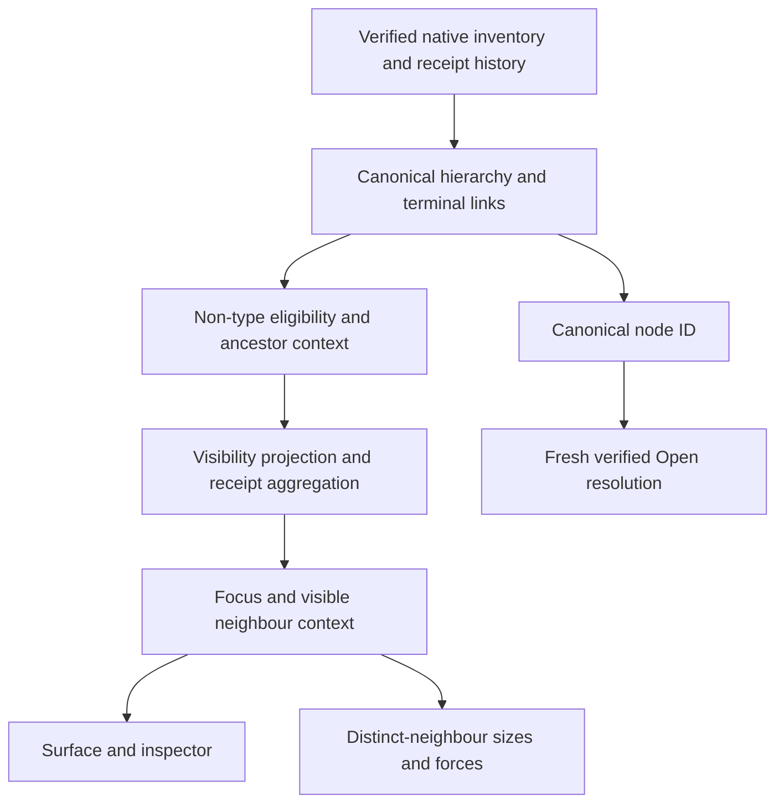

# Main checkouts and graph visibility projection

## Goal Capsule

- **Objective:** Users can see which checkout their terminals occupy and follow recorded relationships at any visible level of Graph.
- **Means:** Add an evidenced main-checkout hub and project the canonical graph through existing visibility controls (KTD1–KTD4).
- **Authority:** The maintainer's supplied brief settles product scope; repository instructions govern implementation and checks. This request intentionally supersedes the documented no-reparent rule.
- **Execution:** One independent ready PR to `christso/ovis`, base `christso/main`. This agent implements, verifies, reviews and opens it; the maintainer owns merge and deployment.
- **Start gate:** Planning only until the parent in `w2B:p2` sends the merged-main SHA after #47. Fetch `origin`'s `christso/main` and fast-forward this clean branch to that exact SHA before implementing. Keep the uncommitted plan only if it does not conflict. Do not cherry-pick #47 or stack on its branch.
- **Stop conditions:** Stop at the ready PR. Do not merge, deploy, install Herdr, manipulate user panes or open an upstream Herdr issue.

### Coordination record

This is the authoritative task entry required by `docs/development.md#coordinated-work`, recorded before implementation.

| Field | Value |
| --- | --- |
| owner | Separate Herdr codex-compound agent, `w3C:p1` |
| scope | Graph main-checkout hierarchy, visibility projection and their coverage |
| branch/worktree | `feat/graph-worktree-projection`, existing checkout of that name under `~/.herdr/worktrees/herdr-web-ui/` |
| start SHA | `f10d372d7a5130f3274df853a8a5f53e3affcef0`; implementation baseline must become the parent's exact merged-main SHA |
| dependencies | #47 merged, including its terminal model and parent-working halos; SHA notification from parent |
| verification | Targeted model units, fast checks and affected browser regressions in CI runner image; actual results and skips reported at completion |
| status | Planning only; no behavior changes or PR authorized before the SHA notification |

---

## Product Contract

### Summary

Git-backed workspace groups show Workspace → Worktree → Terminal for both the main checkout and linked checkouts.
Plain folders keep Workspace → Terminal.
Hiding node types changes the displayed projection of the same recorded graph, so relationships remain visible at an eligible containing level.

### Problem Frame

The current hierarchy treats terminals on the main Git checkout differently from terminals in linked worktrees.
Visibility also removes incident edges outright, losing evidence between still-visible containers and disconnecting visible descendants when their container is hidden.
Users need consistent checkout context and useful coarse views without creating new ownership claims or terminal actions.

### Requirements

**Hierarchy and identity**

- R1. Add an orange worktree node for a main checkout when native workspace checkout metadata establishes it. Attach that workspace's terminals to this node; retain linked-worktree grouping from Herdr.
- R2. Preserve native workspace names, checkout paths and known branch metadata. “Main checkout” describes a location, never an invented branch named `main`.
- R3. Plain folders keep their direct workspace-to-terminal hierarchy. Missing checkout metadata, equal labels, Git-looking paths or branch tokens alone do not establish repository ownership.
- R4. Preserve empty workspaces, evidenced empty main checkouts, orphan linked worktrees and disconnected/unavailable inventory. An orphan gets no invented workspace ancestor.

**Projection and evidence**

- R5. Support all eight visibility modes below. When a container is hidden, connect each visible descendant to its nearest visible evidenced ancestor, where one exists.
- R6. Map a hidden terminal's recorded relationship endpoint to its nearest eligible visible ancestor. Visible terminals retain their original endpoints. Omit an edge if either endpoint has no eligible representative or both representatives are the same node.
- R7. Aggregate by projected source, projected target and relation kind, preserving direction, deduplicated receipt counts, latest timestamp and source provenance. Communication, delegation and containment remain distinct. Do not infer cross-producer event equivalence without a shared event identity.
- R8. Preserve underlying endpoint identity, historical ownership and unmapped read-only activity. Projection never creates a receipt, invents an endpoint mapping or authorizes an Open action.
- R9. Search, status, completed, machine and focus filters retain evidenced context through hidden levels. A type toggle may collapse an eligible endpoint; another filter excluding that terminal must not silently promote it into a visible container link. Focusing a visible collapsed container retains its projected relationship neighbours and their ancestor context.

**Interaction and compatibility**

- R10. Size nodes by distinct neighbours in the projected graph and run layout on that graph. Preserve viewport, settled polling, connected dragging, reduced motion, accessible legend toggles, machine membership and existing type colours.
- R11. Preserve #47's working-parent indication, including live working descendants beneath a hub whose rolled-up status is Done or Input. Compute this from canonical descendants independently of type visibility; stale/disconnected work does not animate.
- R12. Open resolves the selected canonical node against fresh verified inventory, retaining exact terminal/occupant guards. Main checkout Open uses only its own current terminals; workspace Open does not substitute a linked child's terminal. No focus or input is sent to Herdr.
- R13. Keep stored formats and existing ID meanings compatible. Any necessary change to stored meaning must instead follow passive migration, old-open-page, future-data and rollback preservation rules in `docs/development.md#stored-format-changes`.

### Visibility truth table

`W` = workspace, `C` = checkout/worktree, `T` = terminal. Arrows below describe parent-to-child display; internal containment edges remain child-to-parent.
Receipt endpoints in the table must already be evidenced and pass the non-type filters.

| W | C | T | Git containment | Plain-folder containment | Recorded relationship endpoints |
| --- | --- | --- | --- | --- | --- |
| on | on | on | W → C → T | W → T | Original T → T |
| on | on | off | W → C | W alone | C → C for Git; W for a plain-folder endpoint |
| on | off | on | W → T | W → T | Original T → T |
| on | off | off | W alone | W alone | W → W |
| off | on | on | C → T | T alone | Original T → T |
| off | on | off | C alone | No nodes | C → C; plain-folder endpoints omitted |
| off | off | on | T alone | T alone | Original T → T |
| off | off | off | No nodes | No nodes | No edges |

Mixed Git/plain edges use each endpoint's own ancestry.
An orphan linked worktree remains C → T when both kinds are visible; when C is hidden it has no W to fall back to.
Every row omits collapsed self-links and endpoints with no visible ancestor.

### Scope boundaries

Use existing controls, evidence producers and navigation.
No extra folder node, manual relationship editor, new settings, repository/machine inference, Herdr changes or message-content capture is included.
Historical endpoints without verified current location remain read-only activity; adding speculative container links for them is outside this change.

---

## Planning Contract

### Evidence and assumptions

The starting checkout uses tabs and optional panes; #47's inspected worktree has the intended `terminal` model at `91eca201` plus uncommitted working-parent changes.
Those files are provisional evidence, not the implementation baseline; reread the merged versions after the start gate.

`WorkspaceWorktreeInfo` already supplies `checkout_path`, `is_linked_worktree`, `repo_key`, `repo_name` and `repo_root` in `shared/herdr-api.generated.ts`.
`worktreeGroups` in `src/lib/workspaceOrder.ts` establishes grouping separately within each machine, including nearest preceding main-workspace ownership.
No server or wire change is needed for the proposed design.

`shared/graph-relationships.ts` deduplicates native/fork/CLI receipt identities before `graphInventory` resolves them to one unambiguous current terminal and combines parallel pairs.
Projection can aggregate those disjoint original edges without rereading stores or inventing a second event identity scheme.
Unresolved activity never enters that drawable edge set.

The UI follows the existing distinction between project and checkout context, also seen in [Zed's project-grouped parallel threads](https://zed.dev/docs/ai/parallel-agents), where linked-worktree threads remain under their project.
Ovis adds a graph projection because its existing view also shows recorded relationships; no external code or visual assets are copied.
Name this reference and reason in the eventual PR and DESIGN.md entry, as `src/AGENTS.md` requires.

### Key Technical Decisions

- KTD1. **Extend the canonical hierarchy before filtering.** Create an additive, distinct main-checkout hub only from native metadata; retain existing workspace and linked-worktree IDs and the current hub navigation membership. Use the same machine/lifetime/workspace/occupant identity guards for the new hub. Governs R1–R4 and R12. Plain folders retain W → T (session-settled: user-directed — chosen over an extra Folder or fabricated Git node: the maintainer explicitly keeps plain folders direct).
- KTD2. **Project visibility rather than mutate inventory.** Build ancestry from the complete evidenced hierarchy, then derive display representatives and containment through hidden levels. Keep raw nodes, receipts, ownership and action resolution intact. Governs R5, R6 and R8 (session-settled: user-directed — chosen over the previous no-reparent rule: hidden levels must preserve visible context and recorded relationships).
- KTD3. **Aggregate original deduplicated terminal edges once.** Bucket eligible original edges by projected ordered endpoints and kind; sum counts, take the latest timestamp, union source provenance and omit self-links. Apply the existing recent/all/none rule to original relationships before collapse; “recent” continues to mean a relationship whose latest receipt is within 24 hours, without changing its existing count semantics. Governs R7–R9.
- KTD4. **Separate non-type eligibility, projection and focus context.** Evaluate search/status/completed/machine on the original inventory, carrying ancestors as context through hidden types. Project eligible terminal relationships, then apply original focus membership plus the selected visible representative's projected neighbours and their ancestors. Retain support for legacy focus-group IDs. Excluded terminals do not regain edges through a retained ancestor. Governs R9.
- KTD5. **Feed one projected graph to display, sizing and forces.** Continue using `projectGraph` as the display boundary. Preserve #47's canonical descendant activity flags; main and linked checkout hubs aggregate their own terminals and workspace activity includes its evidenced children. Governs R10–R11.
- KTD6. **Keep #47's v3 browser store.** Node additions do not change the meaning of selected IDs, filters, positions or viewport; existing IDs remain exact. Keep `ovis:graph:v3`, URL fields and legacy stores unchanged. Additive nodes receive normal new positions while the user's viewport remains. If implementation needs different stored semantics, stop that design and plan an isolated versioned store with the complete compatibility matrix before writing it. Governs R13.

### Main flow

1. Inventory resolves current terminal identities and deduplicated recorded relationships, then builds the complete evidenced hierarchy, including main checkouts.
2. Non-type filters establish eligible terminals and context. Visibility chooses each eligible node's visible representation and bypasses hidden containment levels.
3. Projection aggregates recorded links and applies focus context; the surface, inspector, appearance and simulation consume the same projected result.
4. Open continues to resolve the selected canonical ID through fresh inventory, independently of any collapsed relationship.

The visibility truth table defines the mode combinations; this flow defines the data boundary between evidence, display and action.

### Dependencies and blocking findings

The only known implementation gate is the parent's merged-main SHA after #47.
No feasibility blocker was found in metadata, receipt identity or the existing harnesses.
Unknown helper names, final fixture counts and any simulation-signature adjustment are implementation details to resolve against the merged baseline.

---

## Implementation Units

All units belong to the same independent PR, in dependency order.

### U1. Add the evidenced main-checkout hub

**Requirements:** R1–R4, R11–R12; KTD1 and KTD5. **Dependencies:** Start gate.

**Files:** `src/features/graph/graphHierarchy.ts`, `graphHierarchy.test.ts`, `graphInventory.test.ts`, and relevant `src/lib/i18n.ko.ts`, `i18n.ja.ts`, `i18n.zh.ts` entries. Update `graphInventory.ts` only where hub target integration needs it.

**Approach:** Add a separate main-checkout hub to the existing native group, move only its own containment edges and include it in focus groups. Use translated “Main checkout” as location wording; leave the workspace label and actual branch metadata intact. Keep workspace navigation membership separate from linked descendants. Preserve #47's activity propagation through the added level.

**Test scenarios:**

- A Git workspace on a branch named `release`, with one linked worktree, yields one W, a main C, a linked C and exact T children; no branch named `main` appears.
- A plain folder or workspace lacking checkout metadata yields W → T; equal labels across machines or repositories never merge hubs.
- Empty Git and folder workspaces remain; an orphan linked checkout gets no invented W; missing/disconnected snapshots preserve freshness and disable unsafe targets.
- Main-checkout and workspace Open select only their own verified terminals; an empty main checkout cannot open a linked terminal. Changed lifetime or occupant invalidates the old selection.
- Working terminals on main and linked checkouts light the correct ancestors, including Done/Input parents; stopped or disconnected work clears live activity.

**Verification:** Hierarchy and target tests prove exact membership and action guards; they do not prove rendered navigation or animation.

### U2. Project containment and recorded relationships

**Requirements:** R5–R9; KTD2–KTD4. **Dependencies:** U1.

**Files:** `src/features/graph/graphModel.ts`, `graphModel.test.ts`, `graphInventory.test.ts`; keep receipt producers and registry schemas unchanged.

**Approach:** Replace incident-edge deletion with the projection flow. Preserve original endpoint relations and action IDs. Replace the deliberate no-reparent assertions. Use table-driven expectations for the truth table, with mixed Git/plain and orphan endpoints.

**Test scenarios:**

- Each of the eight masks yields exactly the expected nodes, nearest containment and directed receipt endpoints; only-T yields original terminal links and all-off is empty.
- Multiple terminal pairs collapse into one ordered pair with exact summed deduplicated counts, latest time and mixed source provenance. Reverse-direction edges and delegation stay separate.
- Exact duplicate receipt replay does not increase a projected count; unrelated observations from different producers are not guessed to be duplicates.
- Links inside one checkout/workspace disappear when both endpoints collapse there; missing/ambiguous ownership and unresolved activity produce no new edge.
- Search matches a hidden terminal and retains its visible ancestors through a hidden worktree. Excluded completed/status/machine/search endpoints do not regain receipts through those ancestors.
- Focus on a visible collapsed C or W retains evidenced projected neighbours; legacy focus groups still work, an unavailable focus stays unavailable and hidden focus IDs do not acquire a new action.
- Recent/all/none filtering happens before aggregation and preserves the existing delegation policy and relationship count semantics.

**Verification:** Pure model tests establish evidence conservation and filter semantics; inventory tests prove deduplication and unverified endpoints at the producer boundary. Browser tests cover inspector integration.

### U3. Preserve layout, sizing, state and working feedback

**Requirements:** R10–R13; KTD5–KTD6. **Dependencies:** U2.

**Files:** `src/features/graph/graphAppearance.test.ts`, `graphSimulation.test.ts`, `graphState.test.ts`, `GraphView.tsx`, `GraphSurface.tsx`; adjust `graphAppearance.ts`, `graphSimulation.ts` or `useGraphSimulation.ts` only if projected topology exposes a real gap.

**Approach:** Keep appearance and forces on the projected graph and inspector relationship rows on projected edges. Preserve the selected canonical node and viewport when its type hides. Avoid reheating on receipt-count-only or equivalent inventory polls; topology changes must update forces. Reuse v3 persistence and its existing compatibility tests.

**Test scenarios:**

- For each mask, degree counts distinct projected neighbours across all relation kinds; parallel receipts, replies and self-links cannot inflate radius or springs.
- Main and linked C nodes use the existing orange token; workspaces and terminals retain their colours.
- Hiding/restoring a level updates containment and forces without fitting/resetting the viewport. Equivalent polls remain settled, while reduced motion settles without animation.
- Mixed Done/Input and live Working descendants retain parent feedback when T is hidden; freshness and stopped-work behavior match #47.
- Existing v3 selection/viewport/positions survive additive hierarchy changes. Existing v1/v2/kinds/panes migration, old/new writers, rollback and future-store byte-preservation tests continue to pass without legacy corrective writes.

**Verification:** Units establish sizing and force inputs; browser regressions prove viewport, animation, accessibility and storage behavior in React. No new storage migration is expected.

### U4. Exercise the integrated UI and document the new contract

**Requirements:** R1–R13. **Dependencies:** U1–U3.

**Files:** `scripts/graph-fixture.tsx`, `scripts/graph-browser-regression.ts`, `scripts/graph-app-demo-regression.ts`, `scripts/graph-herdr-regression.ts`, `docs/graph.md`, `DESIGN.md`, and a new `changelog.d/` fragment.

**Approach:** Extend existing fictional fixtures with main/linked/plain/orphan inventory and real synthetic cross-checkout/cross-workspace receipts. Replace old no-reparent and node-count assertions. Document the hierarchy, projections, unchanged action boundary and unchanged stores; remove superseded current-contract wording in place.

**Test scenarios:**

- Desktop and phone legend controls traverse all eight masks using click/tap and keyboard, retaining pressed state, type colour, viewport and reload/URL/history behavior.
- Collapsed C and W inspector rows show correct direction, counts, latest time and sources; self-links vanish, and original T rows return when restored.
- Search/focus/working filters retain honest ancestry and projected neighbours, with main/linked parent halos and reduced-motion checks from #47 preserved.
- Real-App fixtures open the exact main-checkout, linked-checkout and split-terminal targets; terminal replacement or historical activity cannot authorize Open, focus or input.
- Move/history/dedup behavior and settled polling remain covered by the existing fictional Herdr fixture; fixture updates do not weaken those assertions.

**Verification:** The three existing graph browser runners pass in the CI runner image. Documentation and translations agree with the observed UI; no new browser runner is required.

---

## Verification Contract

### Existing coverage and planned additions

Existing means source-inspected tests, including the provisional #47 additions; it does not mean a check ran during planning.

| Seam | Existing coverage | Add or intentionally replace |
| --- | --- | --- |
| Hierarchy model | `graphHierarchy.test.ts`: native grouping, plain folders, empty/orphan hubs, guarded Open; #47 parent activity | Main C and its exact terminal/target membership, empty main C, working propagation through it |
| Visibility model | `graphModel.test.ts`: type hiding, search/focus, missing focus, recent/all/none; #47 working filter | Replace no-reparent assertions; all eight masks, projected receipt arithmetic, hidden context and collapsed-container focus |
| Inventory/evidence | `graphInventory.test.ts`: split terminals, duplicate observations, mapped/unmapped history, current ownership and target guards | Multiple original pairs collapsing together, mixed provenance/reverse direction, no history-to-action promotion |
| Appearance/forces | `graphAppearance.test.ts`, `graphSimulation.test.ts`: distinct neighbours, colours, duplicate springs, clustering and dragging | Degree/radius and containment forces from each projected graph, stable equivalent polls |
| Browser state | #47 `graphState.test.ts`: v3, old/new writers, passive legacy migration, rollback/future bytes and URLs | Additive node identities preserve existing state; retain the full compatibility suite |
| Component browser | `graph-browser-regression.ts`: desktop/phone, legend, viewport, motion, colours, persistence; #47 halos | Replace no-reparent assertions; eight masks with cross-workspace receipts, inspector totals, projected focus |
| Real-App browser | `graph-app-demo-regression.ts`: split-terminal Open, lazy chunk, sidebar/history and no control calls | Main C navigation and updated fixture counts; retain exact linked/terminal targets |
| Registry browser | `graph-herdr-regression.ts`: import/dedup, move/history, replacement rejection and viewport | Exercise the new hierarchy without weakening retained receipt/action checks |

### Planned checks

The plan phase runs no tests or builds. The commands below are planned checks, not results.
All implementation checks use a created `TMPDIR` beneath `~/.cache/ovis-tmp/`; delete disposable run state when done and preserve result reports separately when needed.
Follow `docs/development.md` isolation/slot rules and run one check at a time per checkout.

| Check | Scope and required outcome |
| --- | --- |
| Targeted graph units | `bun test src/features/graph/graphHierarchy.test.ts src/features/graph/graphModel.test.ts src/features/graph/graphInventory.test.ts src/features/graph/graphAppearance.test.ts src/features/graph/graphSimulation.test.ts src/features/graph/graphState.test.ts`; new matrix and existing identity/working/storage tests pass |
| Fast checks | `bun run check fast` before every push; generated checks, typecheck, build and unit suites pass |
| Component browser fixture | `scripts/graph-browser-regression.ts` proves projection, inspector, layout, keyboard/touch, desktop/phone, colour, motion and persistence |
| Real-App demo fixture | `scripts/graph-app-demo-regression.ts` proves App/sidebar integration, lazy loading and exact navigation without control calls |
| Fictional Herdr/registry fixture | `scripts/graph-herdr-regression.ts` retains receipt import, dedup, move/history, target replacement and viewport checks |
| Conditional additional checks | Run any additional regression naming a shared component actually modified; run affected integration/contract files if scope reaches server/shared behavior |

Run the three graph browser scripts in the existing `herdr-ci-runner:local` image as its `runner` user, overriding the runner-registration entrypoint for a disposable test container.
Use the isolated `bun run check browser` lane with `BROWSER_PARALLEL=1`, `BROWSER_WORKERS=1` and `BROWSER_SCRIPTS` set to those three script paths, or a separately built `check run --build` for each.
Use a fresh source copy/build, container-local dependencies and temporary isolated session/config/state; expose no host session socket, credentials or user state.
Do not launch or register another GitHub runner.

Full integration/browser, native Windows and macOS checks are not claimed by these targeted runs.
Record precisely what ran and what was skipped in the PR; allow required CI to run after opening it.
No live-user screenshot or terminal session is permitted.

---

## Definition of Done

- The truth table, hierarchy, evidence arithmetic, focus/filter context and exact Open boundaries pass the specified coverage.
- #47's parent-working behavior, viewport and accessibility checks remain intact; no unrelated settings, unfinished experiments or weakened checks remain in the diff.
- Current docs replace the superseded no-reparent rule, translations are complete and a changelog fragment describes the visible change.
- Implementation is simplified and independently reviewed through the existing Compound Engineering workflow, with findings resolved before publication.
- The single grouped push follows a successful fast check. One ready independent PR targets `christso/main`; no merge or deployment is performed.
- The parent receives the PR URL, head SHA, actual checks and skips through Herdr. Until the merged-main SHA arrives, only this uncommitted plan and its review evidence may be written.
